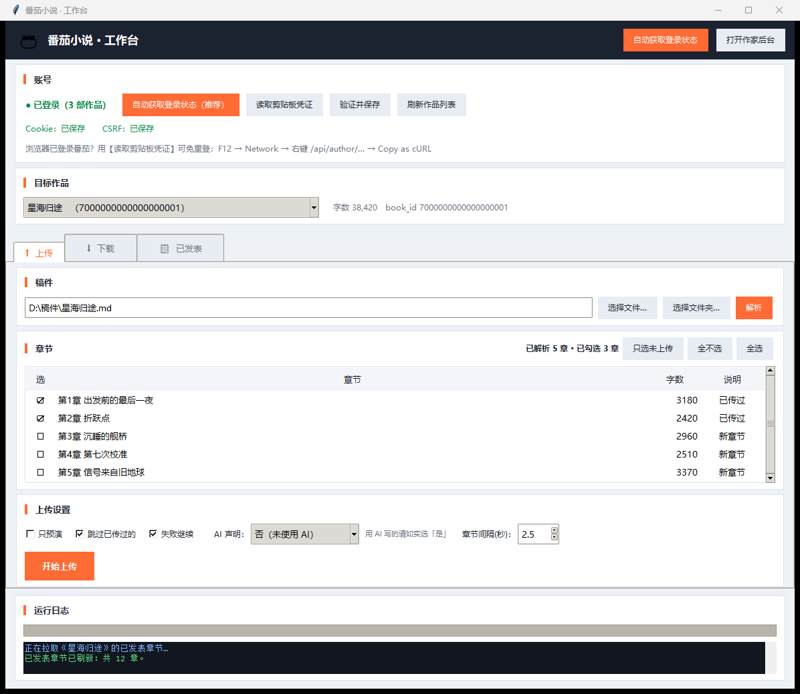
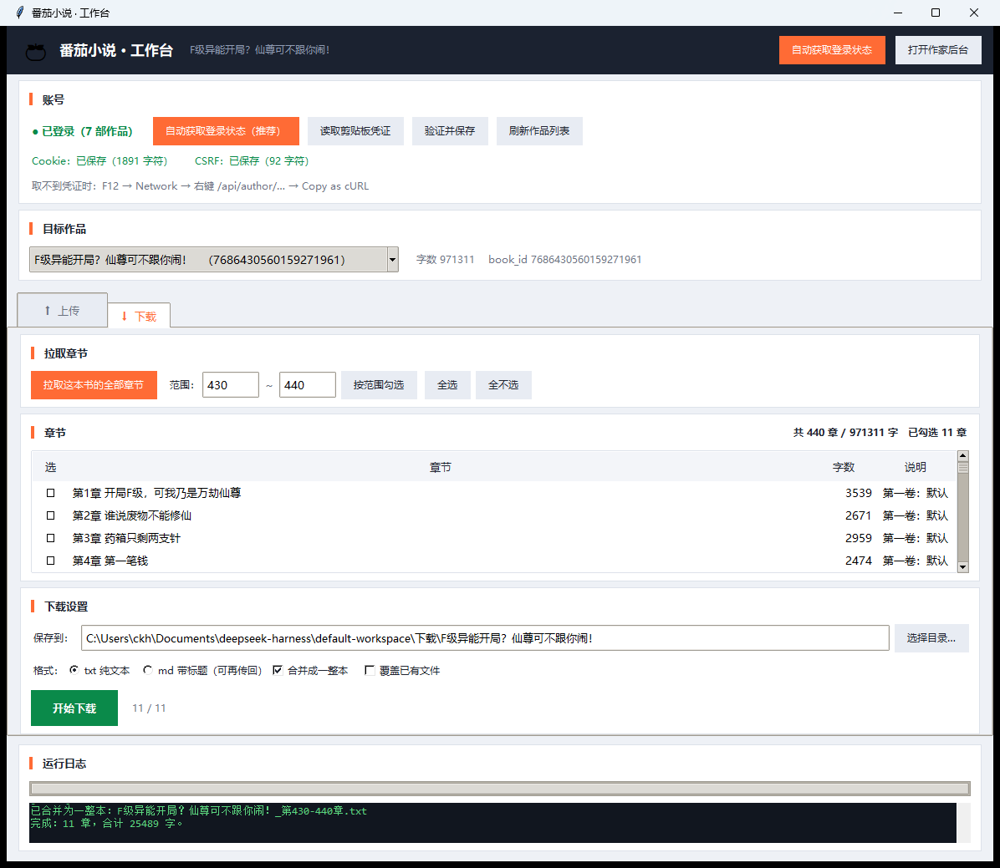
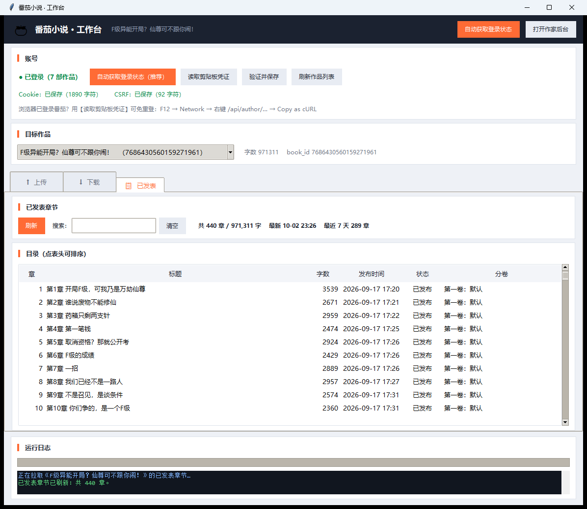
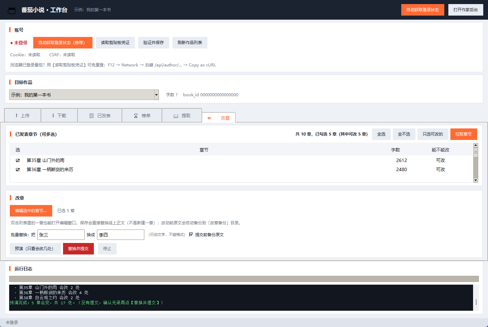
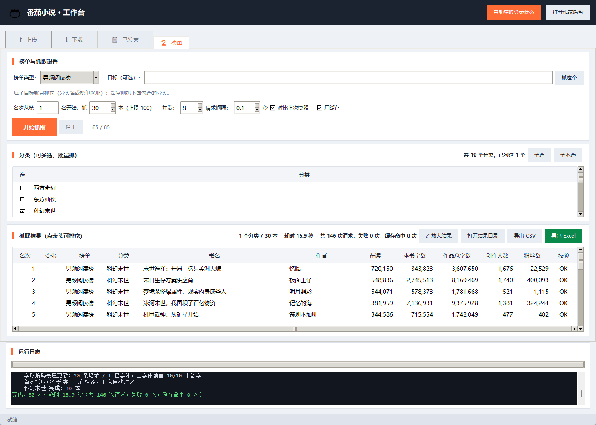
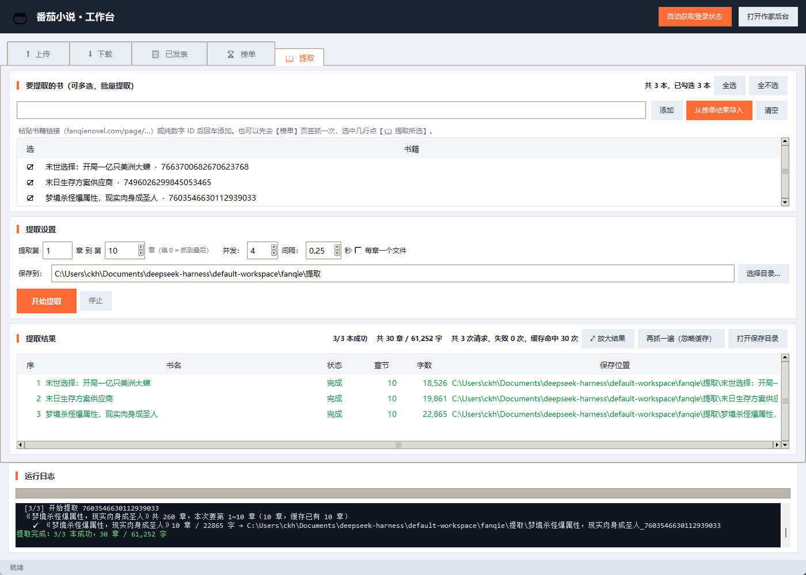

# 番茄小说 · 工作台

一个 Windows 桌面工具：**作家后台**的稿件上传 / 章节下载做成图形界面，另外还能**抓番茄排行榜**、
按章节名**反查是哪本书**、把书的前 N 章**正文提取**下来。

> ⚠️ 上传 / 下载面向**你自己的作者账号**（走作家后台的作者接口，只能访问你自己名下的作品）。
> 榜单与正文提取走的是**公开接口**，请把它抓下来的内容仅用于个人阅读与写作研究，
> 不要再传播或用于商业用途。
> 请遵守番茄平台规则与内容合规要求，不要用于批量灌水或发布非本人创作的内容。

---

## 功能

| | 说明 |
|---|---|
| ⬆ **上传** | 稿件（单文件 / 整个章节文件夹 / docx）自动拆章、转格式、批量提交，支持预演、断点续传 |
| ⬇ **下载** | 单章 / 范围 / 整本下载，可合并成一整本 txt；也能存成带章节标题的 md，直接再传回去 |
| 📋 **已发表** | 查看所有已发布章节的**发布时间、字数、审核状态、所属分卷**，可排序、可搜索 |
| ✏️ **改章** | 改**已发表章节的正文**：批量查找替换 / 单章编辑（不用重发一章），改前自动备份原文 |
| 🏆 **榜单** | 抓番茄各分类排行榜的书 + 作者数据（字数/创作天数/粉丝数），批量、可对比名次变化、可导 Excel |
| 📖 **提取** | 把书的前 N 章正文抓成 txt；也能**只查目录**按章节标题反查是哪本书 |
| 🔑 **自动登录** | 从浏览器自动获取登录凭证，不用手动抓 Cookie |













---

## 快速开始

1. **下载** [fanqie-workbench-v1.3.0.exe](https://github.com/chenkh88/fanqie-workbench/releases/latest)（16 MB，单文件）
2. **放到任意普通文件夹**（桌面、D 盘、U 盘都行），**双击运行**
3. 第一次会静默解压约 4 秒（屏幕上没有提示，别以为卡住），然后弹出窗口
4. 上传 / 下载 / 改章要先点 **【自动获取登录状态】** → 在弹出的专用浏览器窗口里扫码登录番茄 → 凭证自动保存
5. 之后就能正常用了，一两个月内不用再登录（**榜单 / 提取不用登录**，切过去就能用）

> **不需要安装 Python，不需要联网装依赖** —— exe 里自带完整的 Python 运行时。

### 登录的两种方式

- **【自动获取登录状态】** —— 弹出一个工具专用的浏览器窗口，在里面登录一次番茄。
  因为是独立配置目录，**和你日常用的浏览器完全隔离，不会动它**。

  > 为什么不能直接用你已登录的浏览器？因为浏览器厂商从安全层面禁止了：
  > 从 Chrome 136 / 新版 Edge 起，`--remote-debugging-port` **在调试默认数据目录时会被忽略**，
  > 必须配合 `--user-data-dir` 指向非标准目录。
  > 官方说明：<https://developer.chrome.com/blog/remote-debugging-port>

- **【读取剪贴板凭证】** —— 如果你浏览器里**已经登录**了番茄，用这个可以免去重新登录：
  打开作家后台 → `F12` → `Network` → 刷新 → 右键任一 `/api/author/…` 请求 →
  `Copy as cURL` → 回工具点按钮，一步到位。

---

## 改章（修改已发表章节的正文）

**✏️ 改章** 页签，用来改**已经发出去的章节**，两种改法随你切：

- **批量查找替换**：改错别字、改人名、把某个词统一换掉（如「张三」→「李四」）
- **用稿件整章替换**：整段重写后，把**新稿件**丢给工具，它自动对上号、逐章覆盖

两种都走后台「**修改章节**」那条路（**不是重发一章**），改完直接生效到线上，**改前自动备份原文**。

### 用稿件整章替换（v1.3.0 新增）

1. 把「改法」切到 **用稿件整章替换**
2. **选择文件…** —— 支持 **txt / md / docx**，也支持「一章一个文件」的**目录**
3. 点 **【预演（不改任何东西）】**：工具解析稿件 → 和线上章节**配对**
   （先按**章号**配，配不上再按**章名**配）→ 把每章**字数变化**写进列表
   （如 `稿件 3100 字 (-133)`）→ **自动勾选**能改的章
4. 确认字数变化没问题 → **【替换并提交】** → 确认 → 逐章备份原文并覆盖

稿件的三种写法都认：

```text
第38章 白云观之约      ← 最稳：章号 + 章名，按章号配对
## 白云观之约          ← Markdown 标题：只写章名，按章名配对
白云观之约             ← 单独一行也行（能被拆章规则识别）
```

> **只替换、绝不新建**：稿件里有、线上没有的章只会提示你（要新建请用「上传」页签）。
> 配对是**章号优先**的 —— 所以改章稿最好保持原章号，别把第 38 章挪成第 39 章。

### 单章编辑

双击列表里的一章（或勾选一章后点【编辑选中的章节…】）→ 弹出编辑窗口：

- 上面是**标题**，下面是**正文**（一段一行，纯文本，比对着 HTML 改舒服得多）
- 点【保存并替换线上正文】→ 确认 → 原文自动备份 → 提交 → 回查
- 保存时会把纯文本转成平台的正文格式，所以**不用担心自己写 HTML**

命令行同样支持（**不带 `--yes` 就是预演**，一行都不会改）：

```bash
# 查找替换：预演这本书里「张三」会改多少处
python fanqie.py replace --book 书名 --find 张三 --to 李四

# 用稿件整章替换：先看新稿和线上哪些章对上了、字数怎么变
python fanqie.py replace --book 书名 --from-file 新稿.md

# 真提交（原文自动备份；--titles 连标题一起改）
python fanqie.py replace --book 书名 --find 张三 --to 李四 --start 1 --end 30 --yes
python fanqie.py replace --book 书名 --from-file 新稿.md --titles --yes
```

### 出问题怎么办

- **提交后有几秒钟读不回来**：改完一章后后台会短暂进入「审核中」，这时回查会返回
  「作品信息审核中，请勿重复提交」。**这不代表改动失败** —— 工具会自动等 3 秒重试；
  连续几次仍读不回来就写成「已提交；审核中暂时无法回查」，过一会儿自己去看就是新的。
- **日志出现「作品正在审核，本批已停下」**：说明前一次提交触发了审核锁，后面的章现在提交
  也会被拒，所以工具主动停下（不会白刷一串失败）。**等十几秒再点一次**即可继续。
- **「能不能改」列写着「断更作品恢复连载后可修改」**：这本书被判为断更，
  按平台规则要恢复连载之后才能改正文（实测两本断更书都是这个原因），不是工具的 bug。
- **想还原**：去 `改章备份\<书名>\` 找对应时间的备份文件，把正文贴回编辑窗口保存一次。

### 实测记录（写回机制是验证过的）

用「无改动回写」验证过这条路：读一章 → **原样写回** → 回查对比。

```
内容哈希  8b644c8eadbadff7… → 完全一致（一个字都没变）
章节数    74 → 74（没有多出重复章，确认是「修改」而不是「新建」）
该章状态  display_status=1 article_status=1 cant_modify_reason=''
审核锁    提交后约 1 秒即解除
```

> **免责**：改章是直接改动你自己的线上作品，只用于修自己的稿子。
> 提交前请自行确认内容合规。

---

## 榜单与提取（不用登录）

### 🏆 榜单

选分类（可多选）或直接粘榜单网址 → 设名次范围 → **【开始抓取】**。
抓的是书名 / 作者 / 在读 / 作品总字数 / 创作天数 / 粉丝数，「变化」列会和上一次抓取对比出
`↑3`、`↓2`、`NEW`。结果可点表头排序、可导 Excel（按分类分表）或 CSV。

### 📖 提取

- **要正文**：在榜单结果里选中几行 → 点 **【📖 提取所选】** → 跳到提取页签 → 设章节范围
  （默认第 1~10 章，结束章填 0 = 抓到最后）→ **【开始提取】**
- **只想知道某本书的某一章叫什么 / 按章节名反查书**：在「查章节标题」里填关键词 →
  **【在清单里找】**。这走的是**目录接口**，不抓正文、速度快几十倍，也**不会撞风控**。
  例：想找「第 2 章叫『女人只会影响我氪金的速度』」的书，填 `氪金` 就能翻遍上千本榜单书。

> **关于抓取频率**：番茄对正文页有频率限制，连着抓一二百次会被验证码拦住、且一拦十几分钟。
> 工具认出验证码会**立刻停批**（不会傻等也不会刷屏报错），已经抓到的章都在缓存里，
> 过 30 分钟再点一次会**自动接着下**。建议一次先抓 20~30 本，间隔调到 1.5 秒以上。
> 榜单接口和目录接口不受这个限制。

---

## 数据存在哪

全部在 `%LOCALAPPDATA%\番茄工作台\`：

```
%LOCALAPPDATA%\番茄工作台\
├── runtime-v1\     程序运行时（首次运行解压，约 44 MB）
└── data\
    ├── .fanqie-auth.json    登录凭证（等同账号密码，别外发）
    ├── .fanqie-state.json   已上传章节记录（断点续传用）
    ├── browser-profile\     专用浏览器配置（含登录态）
    ├── 榜单\                 榜单缓存 / 快照 / 导出的 Excel
    ├── 提取\                 提取下来的正文 + 章节目录缓存
    ├── 改章备份\             改章前的原文备份（改错能还原）
    ├── autologin.log        自动登录日志（排错用）
    └── 下载\                 默认下载目录
```

按 Windows 用户隔离，所以**同一台电脑上不同用户各登各的，互不影响**。

想彻底卸载：删掉 exe，再删掉上面那个文件夹即可。

> 想让数据跟着 exe / U 盘走：设环境变量 `FANQIE_BASE=D:\番茄工作台` 再双击。

---

## 常见问题

**双击没反应 / 出现 SmartScreen 警告**
这个 exe 没有代码签名，Windows 可能提示"已保护你的电脑"。点「**更多信息**」→「**仍要运行**」。
杀毒软件偶尔也会误报自解压程序，加白名单即可。

**提示 `UnauthorizedAccessException: 对路径 ... 的访问被拒绝`**
说明 exe 被放在了特殊目录（某些同步盘、映射盘、沙箱目录）。
**把它挪到一个普通本地文件夹**（桌面、D 盘等）再运行。

**自动登录时没弹出浏览器窗口**
看窗口里的「运行日志」，每一步都有记录。日志文件在 `%LOCALAPPDATA%\番茄工作台\data\autologin.log`。

**提取正文时提示「被番茄风控拦住」**
正文页有频率限制，等 30 分钟以上再点一次【开始提取】即可，已经抓到的章会自动跳过、接着下。
同时把「并发」调到 2、「间隔」调到 1.5 秒以上。

**榜单结果里「校验」列显示 CHECK 是什么意思**
这一行的数字有一项没对上（多半是字形表覆盖不全，或作者名下作品数被平台截断）。
日志会说明原因，多抓几本通常会自愈；也可以 `--no-cache` 重抓一次。

**换电脑要重新登录吗**
要，登录态不会跟着 exe 走（故意的，包里带账号密码太危险）。每台电脑登录一次即可。

---

## 关于「是否使用 AI」声明

上传时可以选 AI 生成声明。**用 AI 生成/辅助创作的稿子请如实选择「是」。**
依据《人工智能生成合成内容标识办法》，AI 生成内容需要标识。

---

## 从源码构建

需要 Windows + 一个带 tkinter 的 Python 3.10+（或直接用仓库里的 `python\` 目录）。

```bat
python build_exe.py
```

会调用 Windows 自带的 C# 编译器 `csc.exe` 打出一个单文件 exe（**不依赖网络，不需要 PyInstaller**）。
版本号只在 `fanqie.py` 里的 `__version__` 维护一处，界面标题和 exe 属性都会跟着变。

也可以打成「绿色版文件夹」（自带 Python，双击 bat 即用，不用解压到系统目录）：

```bat
python pack_portable.py
```

目录结构：

```
fanqie\
├── fanqie.py         核心：上传 / 下载 / 登录 / 作家后台接口封装
├── gui.py            图形界面（tkinter，五个页签）
├── rank.py           榜单抓取（公开接口，不需要登录）
├── extract.py        正文提取 + 只查目录找章节
├── charset.json      正文解密用的私用区字母表
├── browser_login.py  浏览器自动取凭证（自实现的极简 WebSocket + CDP）
├── build_exe.py      单文件 exe 构建脚本
├── pack_portable.py  绿色版打包
└── python\           自带 Python 运行时
```

> 维护提醒：新增模块后要同步加进 `build_exe.py` 的 `PAYLOAD_FILES`，
> 否则打出来的 exe 里对应页签会显示「不可用」。

---

## 免责声明

本工具仅供自动化整理与投递**自己的稿件**使用；榜单与正文提取抓取的是公开数据，
版权归原作者与平台所有，请仅用于个人阅读与写作研究，不要传播或商用。
使用者需自行遵守番茄平台的规则与内容合规要求，因使用本工具产生的任何后果由使用者自行承担。
